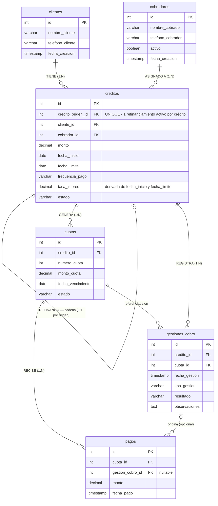

# Sistema de Cobranzas — Entendimiento del Proyecto
> Basado en: MER (Notación Chen), Diagrama Relacional (dbdiagram.io), Script SQL y código fuente Spring Boot.

---

## Stack Tecnológico
| Capa | Tecnología |
|------|-----------|
| Backend | Spring Boot 4.1.2 · Java 21 · Maven |
| BD | PostgreSQL (`cobranzas` en localhost:5432) |
| ORM | Spring Data JPA + Hibernate (`ddl-auto: validate`) |
| Seguridad | Spring Security + JWT |
| Utilidades | Lombok, Bean Validation |

---

## Modelo de Datos



### Estados posibles
| Entidad | Estados válidos |
|---------|----------------|
| `creditos.estado` | `AL_DIA` · `PAGADO` · `REFINANCIADO` |
| `cuotas.estado` | `PENDIENTE` · `PAGADA` |
| `creditos.frecuencia_pago` | `DIARIA` · `SEMANAL` · `QUINCENAL` · `MENSUAL` |
| `gestiones_cobro.tipo_gestion` | `LLAMADA` · `MENSAJE` · `VISITA` |
| `gestiones_cobro.resultado` | `PAGO_CONFIRMADO` · `SIN_RESPUESTA` · `PROMESA_PAGO` · `ACUERDO_PAGO` · `REFINANCIACION` · `CONTACTO_EXITOSO` · `RECORDATORIO` |

---

## Reglas de Negocio

### Interés y cuotas

- El plazo se determina por `fecha_inicio` y `fecha_limite`, no por la frecuencia de pago.
- 7 días exactos generan 5% de interés; 15 días exactos generan 10%.
- Un mes calendario completo o varios meses completos generan 20% (tasa plana sobre el capital).
- Se aceptan plazos mensuales enteros, no meses y fracciones.
- `frecuencia_pago` determina cuándo se generan las cuotas: diaria, semanal, quincenal o mensual.
- El total financiado es `monto + (monto × tasa_interes / 100)` y se distribuye entre las cuotas. La última cuota absorbe cualquier diferencia de redondeo.
- La base de datos deriva la tasa al insertar o modificar el crédito; no se debe enviar una tasa manual inconsistente.

### 🔑 Regla crítica: Refinanciamiento encadenado

> Un crédito puede ser refinanciado **múltiples veces**, pero con estas condiciones **en cada paso**:

```
Crédito A (REFINANCIADO)
    └──▶ Crédito B (nuevo, credito_origen_id = A)
              └── puede refinanciarse si se pagó el interés generado
              └──▶ Crédito C (nuevo, credito_origen_id = B)
                        └── ...y así sucesivamente
```

**Restricciones por refinanciamiento:**
1. **Un origen → un solo refinanciado activo**: el campo `credito_origen_id UNIQUE` garantiza que un crédito dado solo puede ser el origen de **un** crédito refinanciado. Esto está cubierto en la BD.
2. **Pago previo del interés**: antes de poder refinanciar un crédito, el cobrador debe haber registrado el pago del interés generado. Esta regla **NO está implementada en el código**.
3. **Al refinanciar, el crédito origen pasa a estado `REFINANCIADO`**: tampoco implementado.
4. **Solo el cobrador asignado** puede solicitar/gestionar el refinanciamiento del crédito.

**¿Qué falta implementar?**
- `RefinanciamientoService` con validación: verificar que el crédito origen exista, que no tenga ya un refinanciamiento activo (aunque el UNIQUE de BD lo frena), y que el interés esté pagado.
- Actualizar estado del crédito origen a `REFINANCIADO` al crear el nuevo.

---

### ✅ Reglas ya implementadas
| # | Regla | Dónde |
|---|-------|-------|
| 1 | Solo el cobrador asignado consulta sus créditos | `CobradorConsultaService` |
| 2 | Solo el cobrador asignado registra pagos | `PagoService` (valida `cobrador_id`) |
| 3 | Al pagar, se crea automáticamente una `GestionCobro` | `PagoService` |
| 4 | Se aceptan abonos parciales; la cuota solo pasa a `PAGADA` al cubrir su total, sin permitir sobrepagos | `PagoService` |
| 5 | Se valida el monto del pago y se bloquea la cuota durante el registro para evitar carreras concurrentes | `PagoService` + `CuotaRepository` |

### ⚠️ Reglas pendientes de implementar
| # | Regla | Impacto |
|---|-------|---------|
| A | Pago del interés como prerrequisito del refinanciamiento | Alto — crítico |
| B | Cambio de estado del crédito a `PAGADO` cuando todas las cuotas estén pagadas | Alto |
| C | El `cobradorId` debe venir del token JWT, no del path | Alto — seguridad |
| D | `obtenerCreditosPorCobrador` hace `findAll()` en memoria — ineficiente | Medio |

---

## Alcance del modelo

El campo `promesa_pago` no forma parte de los requisitos y no debe agregarse al esquema ni a `GestionCobroEntity`. El resultado `PROMESA_PAGO` en una gestión se conserva como clasificación del contacto, sin una fecha asociada.

---

## Estructura de Capas

```
src/main/java/com/ud/cobranzas/
├── CobranzasApplication.java
├── controller/
│   ├── MainController.java          → GET /api/clientes, /creditos, /cuotas/credito/{id}
│   └── CobradorController.java      → GET  /api/cobradores/{id}/creditos
│                                      GET  /api/cobradores/{id}/creditos/{id}/cuotas-pendientes
│                                      POST /api/cobradores/{id}/pagos
├── model/
│   ├── dto/
│   │   └── PagoRequestDto.java      → cuotaId, monto, tipoGestion, observaciones
│   └── entity/
│       ├── ClienteEntity.java
│       ├── CobradorEntity.java
│       ├── CreditoEntity.java        ← tasaInteres calculada por la BD
│       ├── CuotaEntity.java
│       ├── GestionCobroEntity.java
│       └── PagoEntity.java
├── repository/
│   ├── ClienteRepository.java
│   ├── CobradorRepository.java
│   ├── CreditoRepository.java       → findByClienteId (falta findByCobradorId)
│   ├── CuotaRepository.java         → findByCreditoId
│   ├── GestionCobroRepository.java
│   └── PagoRepository.java
└── service/
    ├── CobradorConsultaService.java  → usa findAll() ineficiente
    └── PagoService.java              → registrarPagoPorCobrador (transaccional ✅)
    ← falta: RefinanciamientoService
```

---

## Entregables SQL

El script `V2__datos_vistas_consultas.sql` incluye:

| Requisito | Implementación |
|-----------|----------------|
| 2 JOIN de tipo diferente | `INNER JOIN` para pagos con sus relaciones y `LEFT JOIN` para cartera completa por cobrador |
| 2 subconsultas de tipo diferente | Escalar en `WHERE` para comparar créditos con el promedio y correlacionada con `EXISTS` para clientes en mora |
| Vista normal | `vista_cuotas_vencidas` |
| Vista materializada | `vista_resumen_creditos`; requiere `REFRESH MATERIALIZED VIEW` después de cambios |
| Transacción | Refinanciamiento con bloqueo, validaciones, alta de crédito y cuotas, y refresco de la vista materializada |

## Interfaz web local

La aplicación Spring sirve una interfaz en `/` con resumen, listado de clientes y créditos, detalle de cuotas e historial de gestiones. Permite crear clientes y créditos, registrar gestiones y registrar abonos de pago. Al crear un crédito, el backend calcula su tasa y crea cuotas con el total de capital más interés según la frecuencia seleccionada. Para bases ya existentes, aplicar primero `V3__reglas_plazo_interes.sql`.

La selección de cobrador en la interfaz es solo para demostración; no existe autenticación de identidad y las rutas están abiertas en esta configuración. No exponer la aplicación en una red pública ni usarla con datos reales hasta implementar inicio de sesión y autorización por rol.

## Vistas SQL disponibles en la BD
| Vista | Descripción |
|-------|-------------|
| `vista_cuotas_vencidas` | Cuotas `PENDIENTE` con fecha pasada + días vencidos |
| `vista_resumen_creditos` | Total cuotas, total pagado y saldo por crédito |

---

## Notas de Configuración

> [!WARNING]
> `application.properties` tiene la contraseña de BD y el secreto JWT **en texto plano**. Para producción, usar variables de entorno o Spring Cloud Config.

> [!NOTE]
> `spring.jpa.ddl-auto=validate` → Hibernate valida el esquema contra las entidades pero NO lo modifica. El esquema debe existir previamente (creado con el script SQL). La entidad `CreditoEntity` expone `tasa_interes` como campo de solo lectura porque la base de datos calcula su valor.
